# AssetStudio 资源排查使用指南

> 适用版本：Studio v1.36.00（当前仓库代码）
> 更新日期：2026-11-04
> 截图环境：Windows 10，样例为从一份本地测试 APK 中抽取的 bundle 集合；AssetStudio 状态栏显示读取 71 个文件、370 个可浏览资源。截图中的资源名、路径仅用于演示。

本文重点介绍 AssetStudio 的资源排查功能：如何加载资源、如何按类型和条件筛选、如何检查纹理与 Mesh 的常见问题、如何定位重复资源和异常 AB，以及如何预览和导出结果。

---

## 1. 界面总览

主窗口左侧是资源工作区，右侧是预览区。

左侧页签：

| 页签 | 用途 |
|---|---|
| Scene Hierarchy | 场景层级树，按文件 → CAB → GameObject 展开 |
| Asset List | 资源总表，所有排查筛选的主入口 |
| 重复资源检查 | 跨 AB 的重复资源与冗余大小统计 |
| Asset Classes | 按 Unity 版本分组的资源类型清单 |
| AB单体专项检测 | 按 AssetBundle 分组的资源数量与大小 |

右侧页签：

- **Preview**：图片、文本、音频、模型预览。
- **Dump**：查看资源的文本化 Dump。

底部状态栏显示加载进度、资源数量和当前操作提示。

---

## 2. 加载资源

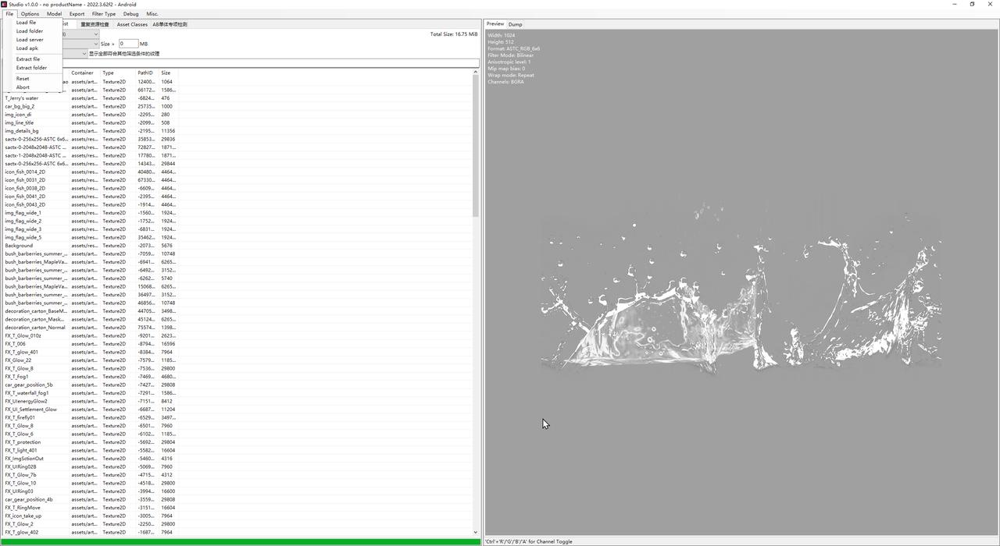

通过 `File` 菜单加载：

| 菜单项 | 说明 |
|---|---|
| Load file | 加载单个 Unity 序列化文件或 bundle |
| Load folder | 加载整个目录，最常用 |
| Load server | 从服务器地址或本地缓存加载热更资源 |
| Load apk | 从 APK 中读取 YooAsset 清单，选择 bundle 及其依赖后加载 |
| Extract file / folder | 只解包，不进入资源浏览 |
| Reset | 清空当前会话 |
| Abort | 中止当前加载 |

### Load apk 的流程

1. 选择 APK 文件。
2. 选择包名（例如 `HotfixPkg`），点击“读取清单”。
3. 在 bundle 列表中搜索并选择目标 bundle。
4. 按需勾选“包含依赖”。
5. 点击加载，工具会把选中的 bundle 抽取到临时目录，再按普通目录读取。

适合排查首包、热更包和单个资源所在的 bundle，不需要先手动解压整个 APK。

### 加载完成后的状态

状态栏会显示类似：

```text
Finished loading 71 files with 370 exportable assets
```

表示读取了多少个文件、生成了多少个可浏览资源。

---

## 3. Asset List：资源总览与基础筛选

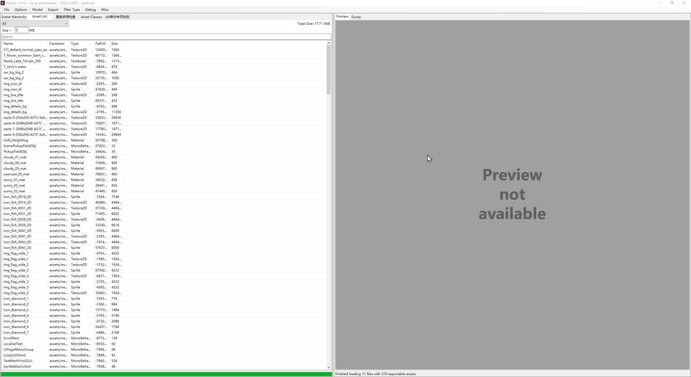

Asset List 是资源排查的主界面。顶部筛选区包含：

1. **类型**：`All` 或 `Texture2D (176) (16.75 MB)` 这样的“类型（数量）（总大小）”。
2. **格式**：仅在类型为 `Texture2D` 时出现。
3. **Size > N MB**：按资源大小过滤。
4. **搜索框**：正则匹配 Name、Container、PathID，按回车生效。
5. **类型专项区**：选择 `Texture2D` 或 `Mesh` 时出现对应的专项条件。

列表列含义：

| 列 | 含义 |
|---|---|
| Name | 资源名 |
| Container | 资源在 AB 中的容器路径 |
| Type | Unity 资源类型 |
| PathID | 序列化文件内的 PathID |
| Size | `FullSize`，字节数 |

右上角的 `Total Size` 是当前筛选结果的合计大小。

> **Size 不是显存占用。** 对 Texture2D，`FullSize` 通常包含序列化对象大小和外部流数据大小；它不等于 GPU 显存，也不等于解码后的 RGBA 内存。

### 常用组合

- 只看纹理：类型选 `Texture2D`。
- 只看某种压缩格式：类型 `Texture2D` + 格式下拉框。
- 找大资源：`Size >` 输入阈值。
- 按名字定位：搜索框输入资源名或路径片段，回车。
- 按 PathID 定位：搜索框直接输入 PathID。

所有条件按 **AND** 组合。

---

## 4. 纹理专项排查

> 旧版本的独立“纹理专项检测”页已取消。当前版本把纹理检查合并进 Asset List，结果直接复用同一个列表、预览和导出链路。

### 4.1 打开方式

1. 进入 `Asset List`。
2. 类型选择 `Texture2D`。
3. 第三行出现“检测”下拉框，右侧显示当前规则的判断说明。

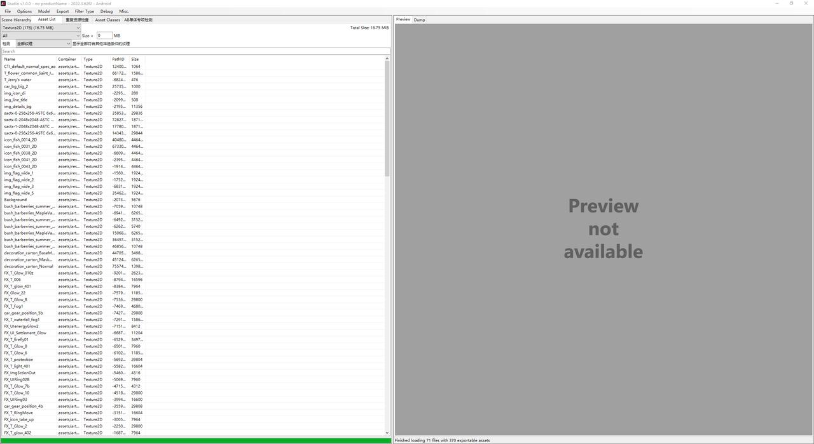

检测规则为单选，可与格式、`Size >`、搜索条件叠加。

在同一批已加载资源中切换类型再回到 `Texture2D`，会保留上次的规则、格式和尺寸档位；执行 `Reset` 或加载新资源时恢复为“全部纹理 + All + ≥2048”，避免旧条件造成“结果看起来变少了”的误解。

### 4.2 六条规则

| 规则 | 实际判断条件 | 适合排查 |
|---|---|---|
| 全部纹理 | 不增加纹理属性条件 | 作为其他筛选的基线 |
| 非块压缩格式 | 格式属于 RGBA32、ARGB32、RGB24、RGBA4444、ARGB4444、RGB565、R16、RGBAHalf、RGBAFloat、BGRA32、RG16、R8 | 未使用 DXT/ETC/ASTC 等块压缩的资源 |
| 大尺寸 | 宽或高任一边 ≥ 所选档位 | 超大贴图、显存压力 |
| Read/Write 已开启 | `m_IsReadable == true` | 会保留 CPU 端副本的纹理 |
| Mipmaps 已开启 | `m_MipMap == true` 或 `m_MipCount > 1` | Mipmap 相关内存与采样问题 |
| 疑似 NPOT 压缩退化 | `RGBA32` + 有 Mipmaps + 宽或高不是 2 的幂 | 非 2 次幂尺寸且走 RGBA32 的疑似配置问题 |

注意事项：

- **“非块压缩格式”不等于“一定有问题”**。它只说明没有使用块压缩；是否合理要结合用途、平台和包体预算判断。
- **“大尺寸”按纹理宽高判断**，不是按文件大小。文件大小请用 `Size >`。
- **“疑似 NPOT 压缩退化”是启发式规则**，只覆盖 `RGBA32 + Mipmap + NPOT` 这一种组合，不代表所有压缩配置问题。

### 4.3 大尺寸档位

选择“大尺寸”后，规则右侧出现档位：

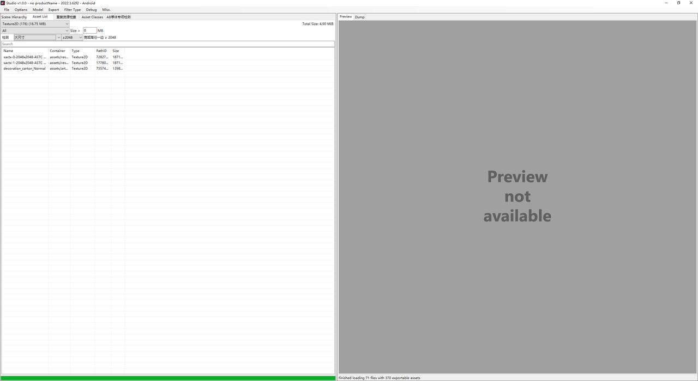

可选：

- ≥1024
- ≥2048
- ≥4096

默认 ≥2048，判断关系为包含（等于阈值也算命中），且宽或高任一边达到即可。

### 4.4 纹理格式筛选

类型为 `Texture2D` 时，格式下拉框会列出当前资源集中实际出现的格式及数量，例如：

```text
All
ASTC_RGB_6x6 (12)
DXT5 (8)
RGBA32 (5)
```

先看格式分布，再叠加检测规则，通常比逐条规则翻列表更快。

### 4.5 纹理预览与通道

选中纹理后，右侧 Preview 显示图片和元信息：

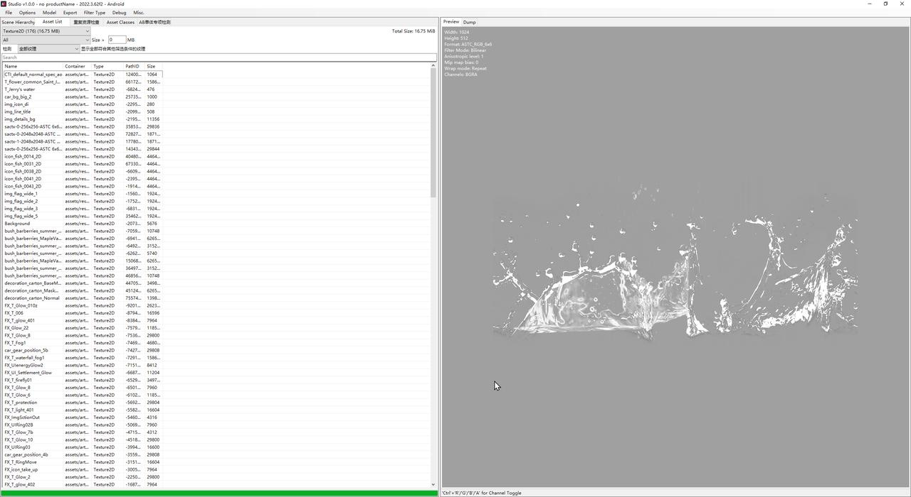

信息包括宽、高、格式、过滤模式、各向异性、Mip bias、Wrap mode 和当前显示通道。

快捷键：

| 快捷键 | 作用 |
|---|---|
| Ctrl+R | 切换红色通道 |
| Ctrl+G | 切换绿色通道 |
| Ctrl+B | 切换蓝色通道 |
| Ctrl+A | 切换 Alpha 通道 |

通道切换适合检查 Alpha 是否正确、法线贴图通道是否异常、遮罩是否写进了错误的通道。

如果预览区显示 `Preview not available`，常见原因：

- 纹理数据在外部流文件中，当前只加载了元数据。
- 资源来自不完整的 bundle 集合，缺少依赖。
- 该资源类型不支持预览。

### 4.6 推荐的纹理排查顺序

1. 类型 `Texture2D`，格式选 `All`。
2. 用“大尺寸” ≥2048 找显存风险。
3. 用“非块压缩格式”找未压缩或低压缩方案。
4. 用“Read/Write 已开启”找可能的 CPU 副本。
5. 用“Mipmaps 已开启”核对 Mipmap 策略。
6. 最后用“疑似 NPOT 压缩退化”做启发式抽查。
7. 选中可疑纹理，结合预览和资源信息确认。

---

## 5. Mesh 专项排查

类型选择 `Mesh` 后，筛选区会出现两个复选框：

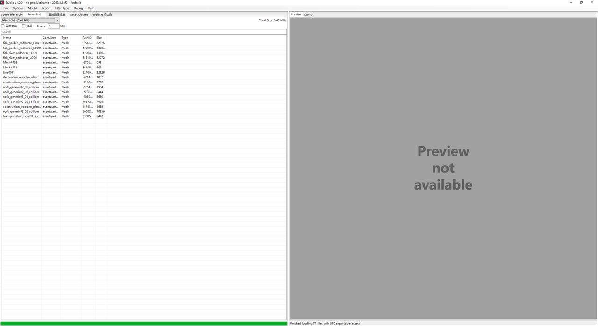

| 条件 | 判断依据 | 说明 |
|---|---|---|
| 双面渲染 | 通过 Mesh → Renderer → Material → Shader 的剔除设置判断 `Cull Off` | Mesh 本身没有双面字段，双面是材质/Shader 配置 |
| 读写 | `m_IsReadable` | Unity 的 Read/Write Enabled，开启后可能保留 CPU 端副本 |

使用要点：

- 两个复选框可以同时勾选，结果取交集。
- “双面渲染”需要能建立 Mesh 与 Renderer、Material 的关联；孤立 Mesh 不会被判定为双面。
- 阴影、深度等辅助 Pass 的 Cull 设置不会单独作为主渲染双面依据。
- 想找“开了读写但没用”的 Mesh 时，先用读写筛选，再结合资源名和引用关系判断。

---

## 6. 重复资源检查

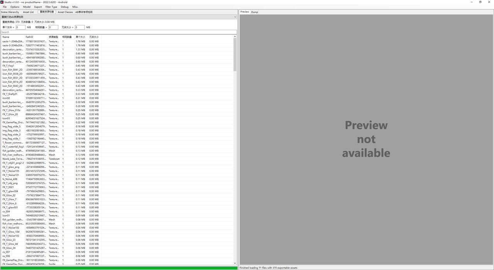

页签顶部显示：

```text
重复资源组: 370  冗余数量: 0  冗余大小: 0.00 MB
```

判定逻辑：

- 同一 AB 内按 `FilePath + Name + PathID + FullSize + Type` 先去重，只保留一条。
- 再按 `Name + PathID + FullSize + Type` 跨 AB 比对。
- 命中跨 AB 重复时累加“相同数量”，并记录所有来源 AB。

筛选项：

| 筛选项 | 作用 |
|---|---|
| 单个文件 > N MB | 只看大于阈值的单资源 |
| 相同数量 > N | 只看重复次数超过阈值的资源 |
| 冗余大小 > N MB | 只看冗余总量超过阈值的资源 |

列表列包括资源名、PathID、类型、相同数量、单个大小、冗余大小。

用途：

- 判断资源是否被重复打进多个 AB。
- 估算可节省的包体空间。
- 结合“AB单体专项检测”定位重复来源。

> 截图中的样例资源集没有跨 AB 重复，所以冗余数量为 0；页面仍会列出全部资源组，便于配合筛选条件查看。

---

## 7. AB 单体专项检测

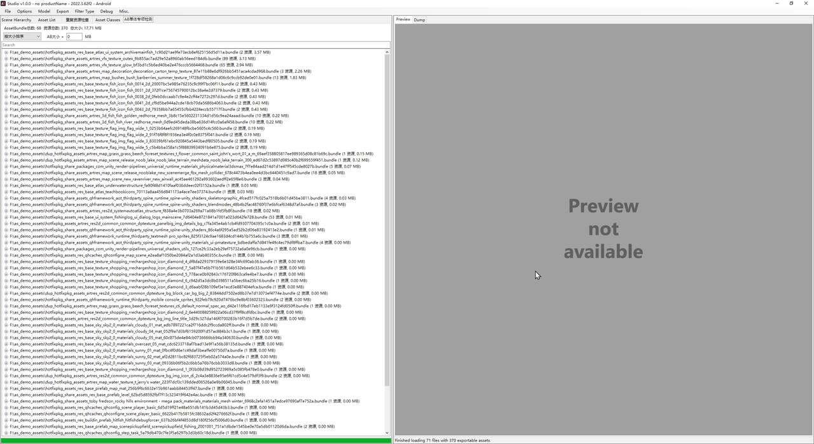

按 AssetBundle 分组展示：

```text
F:\as_demo_assets\xxx.bundle (53 资源, 0.01 MB)
```

每个节点下是该 AB 内的资源。顶部摘要显示 AB 总数、资源总数和总大小。

可用操作：

| 操作 | 作用 |
|---|---|
| 搜索 | 按 bundle 路径或资源名过滤 |
| AB大小 > N MB | 只看超过阈值的 AB |
| 排序 | 按大小 / 名称 / 数量排序 |
| 展开节点 | 查看该 AB 内的资源列表 |

适用场景：

- 找异常大的 AB，判断是否需要拆分或迁移资源。
- 检查某个资源被放进了哪个 AB。
- 排查首包、热更包和公共包的大小构成。
- 结合重复资源页确认是否存在跨 AB 重复。

---

## 8. 场景层级：Scene Hierarchy

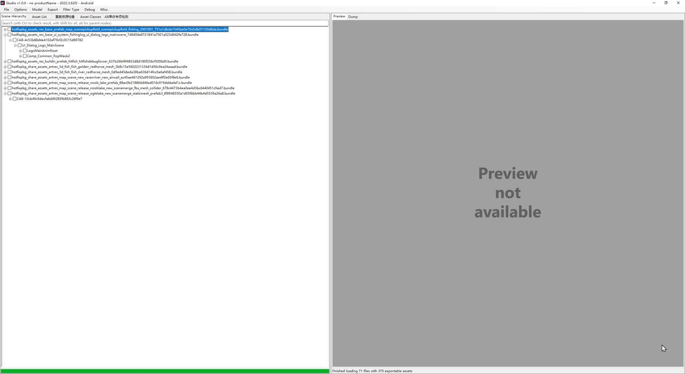

树结构为：

```text
文件 / Bundle
  └─ CAB
      └─ GameObject
          └─ 子节点
```

功能：

- 搜索框支持名称过滤；占位提示中的 Ctrl / Shift / Alt 用于勾选搜索结果的不同范围。
- 节点前的复选框用于选择导出范围。
- 展开节点查看 GameObject 层级和组件引用关系，可用于确认资源挂在哪个对象上。
- 适合检查 UI 预制体结构、模型节点层级和场景引用关系。

排查用途：

- 确认某个 Mesh 或材质实际挂在哪个 GameObject 上。
- 找出场景中重复引用同一资源的节点。
- 按层级导出模型或 UI 资源。

---

## 9. Asset Classes：资源类型分布

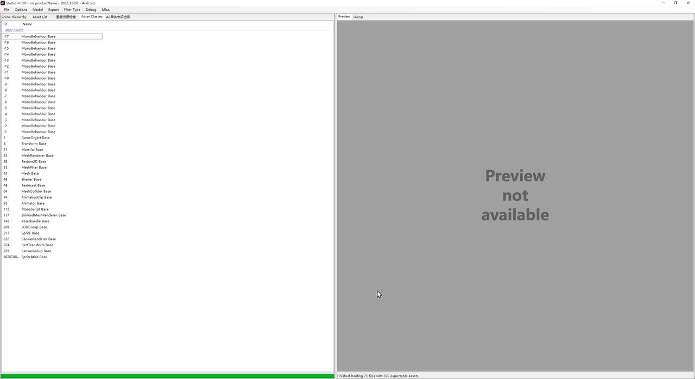

按 Unity 版本分组，列出 ClassID 和类型名，例如：

```text
1  GameObject Base
21 Material Base
28 Texture2D Base
43 Mesh Base
```

用途：

- 快速确认资源集中有哪些类型。
- 判断资源是否来自预期版本。
- 排查“明明有资源但 Asset List 里找不到”的问题：先在类型清单中确认该类型是否存在。

---

## 10. 预览与 Dump

右侧有两个页签：

- **Preview**：图片、文本、音频和模型的可视化结果。
- **Dump**：资源的文本 Dump，适合查看字段和引用。

相关开关在 `Options` 菜单：

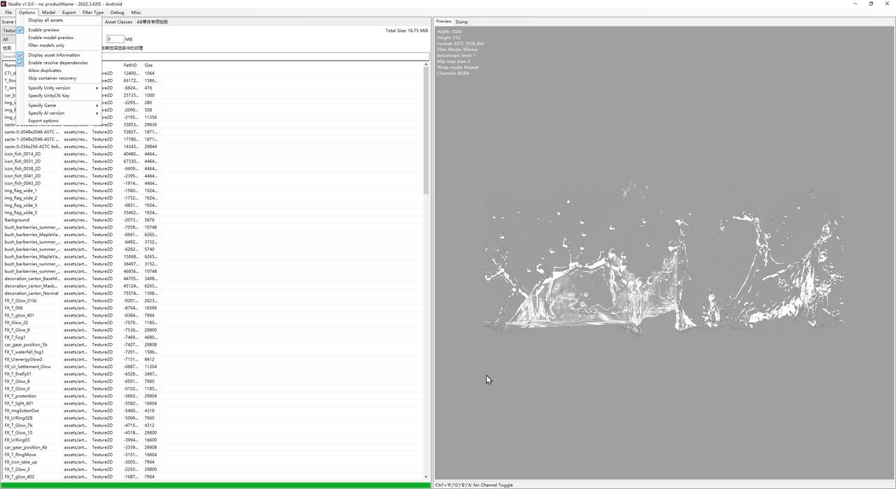

| 选项 | 作用 |
|---|---|
| Enable preview | 关闭后选中资源不执行预览，减少大资源浏览时的开销 |
| Display asset information | 在预览区叠加资源元信息 |
| Enable model preview | 开启模型预览 |
| Filter models only | 只显示带模型的对象 |
| Enable resolve dependencies | 解析资源依赖 |
| Allow duplicates | 允许同名资源同时导出，影响导出时的重名处理 |
| Skip container recovery | 跳过 Container 恢复，加快大量文件的加载 |
| Display all assets | 显示全部类型资源，而不仅是可导出资源；不可导出类型可导出 RAW |

使用建议：

- 批量翻大纹理时先关闭 `Enable preview`，选中目标后再打开。
- 排查字段和引用关系时用 Dump，比 Preview 更直接。
- 模型预览依赖 OpenGL 环境，远程桌面或虚拟机中可能不可用。

---

## 11. 导出与清单

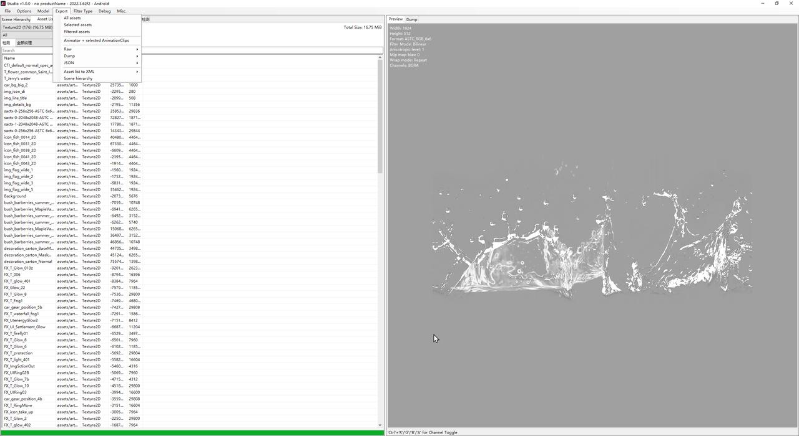

`Export` 菜单分为几组：

| 菜单项 | 说明 |
|---|---|
| Scene hierarchy | 按场景层级导出模型/资源 |
| Asset list to XML | 把资源清单导出为 XML，适合做审计报告 |
| JSON / Dump / Raw | 分别导出 JSON、Dump 文本、原始资源数据；展开后选择导出范围 |
| Animator + selected AnimationClips | 导出 Animator 及选中的动画片段 |
| Filtered assets | 导出当前筛选结果 |
| Selected assets | 导出当前选中项 |
| All assets | 导出全部资源 |
| Model | 模型导出相关选项 |

导出格式与相关选项在 `Options → Export options` 中配置。

推荐的审计流程：

1. 在 Asset List 中组合筛选出目标资源。
2. 用 `Asset list to XML` 留一份清单。
3. 用 `Export → Filtered assets` 只导出这批资源，避免整包导出。

---

## 12. 推荐排查路线

### 12.1 包体异常

1. `AB单体专项检测`：按大小排序，找异常大的 AB。
2. `重复资源检查`：看跨 AB 重复和冗余大小。
3. `Asset List` → `Texture2D`：检查大尺寸和非块压缩纹理。
4. `Asset List` → `Mesh`：检查读写和双面渲染。
5. 导出清单和筛选结果，形成优化项列表。

### 12.2 首包 / 热更包

1. `File → Load apk`，选择包名并读取清单。
2. 搜索目标 bundle，按需勾选依赖后加载。
3. 用 `AB单体专项检测` 查看该 bundle 的资源构成。
4. 用 `Asset List` 检查是否夹带了不必要的大纹理或重复资源。

### 12.3 显存与内存

1. `Texture2D` + `大尺寸`（≥2048 或 ≥4096）。
2. 叠加具体格式，排除已知安全的格式。
3. 勾选 `Read/Write 已开启`，找可能保留 CPU 副本的纹理。
4. 选中纹理，在 Preview 中确认尺寸、格式和 Mip 信息。
5. 注意 `Size` 是资源大小，不是显存；显存判断要结合宽高、格式和 Mipmap 层级。

### 12.4 渲染问题

1. `Mesh` + `双面渲染`，确认是否真的配置了 Cull Off。
2. `Mesh` + `读写`，排查不必要的 CPU 副本。
3. 在 Scene Hierarchy 中定位 Mesh 所属 GameObject 和材质。
4. 用 Dump 查看 Material / Shader 的剔除参数。

---

## 13. 常见误区

**1. “大尺寸”不是按文件大小筛选**

“大尺寸”看的是纹理宽高；文件大小请用 `Size >`。两者可以同时使用。

**2. “非块压缩格式”不是错误标签**

它只表示没有使用 DXT/ETC/ASTC 等块压缩。UI 图标、少量特殊效果使用 RGBA32 可能是合理的。

**3. Read/Write 不等于“会崩”**

它表示 Unity 保留 CPU 端可读副本，会增加内存占用，但是否需要取决于运行时是否读取像素。

**4. 双面渲染不是 Mesh 属性**

双面来自材质或 Shader 的 `Cull Off`。没有 Renderer/Material 关联的 Mesh 无法判定。

**5. 重复资源为 0 不一定正常**

重复检测按 `Name + PathID + FullSize + Type` 跨 AB 比对。资源被重命名、重新打包导致 PathID 变化，或只加载了部分 bundle 时，可能检测不到。

**6. NPOT 规则是启发式**

它只覆盖 `RGBA32 + Mipmap + 非 2 次幂`。命中不代表一定配置错误，未命中也不代表没有问题。

**7. 预览不可用不等于资源损坏**

外部流数据、缺失依赖、特殊格式都可能导致无法预览。以 Dump 和元信息为准。

---

## 14. 速查表

### 14.1 纹理规则

| 规则 | 条件 |
|---|---|
| 全部纹理 | 无附加条件 |
| 非块压缩格式 | 12 种原始像素格式之一 |
| 大尺寸 | 宽 ≥ 档位 或 高 ≥ 档位 |
| Read/Write 已开启 | `m_IsReadable` |
| Mipmaps 已开启 | `m_MipMap` 或 `m_MipCount > 1` |
| 疑似 NPOT 压缩退化 | RGBA32 + Mipmaps + 宽或高非 2 的幂 |

### 14.2 筛选组合

```text
类型
AND 格式
AND 检测规则
AND Size > N MB
AND 搜索（Name / Container / PathID）
```

### 14.3 常用快捷键

| 快捷键 | 作用 |
|---|---|
| Enter | 应用搜索 |
| Ctrl+R / G / B / A | 切换预览通道 |
| 鼠标滚轮 | 模型预览中缩放视角 |

---

## 15. 截图说明

本文截图取自一份用于演示的本地 APK 资源集：

- 状态栏显示 71 个文件、370 个可浏览资源（AB 统计为 68 个）
- 类型覆盖 Texture2D、Sprite、Mesh、Material、Shader、MonoBehaviour、TextAsset 等

截图中的游戏资源名、路径和业务字段仅用于说明功能，不代表任何项目规范或优化结论。

由于样例资源集没有跨 AB 重复，重复资源页显示“冗余数量: 0”，这是数据本身的特征，不是功能异常。
